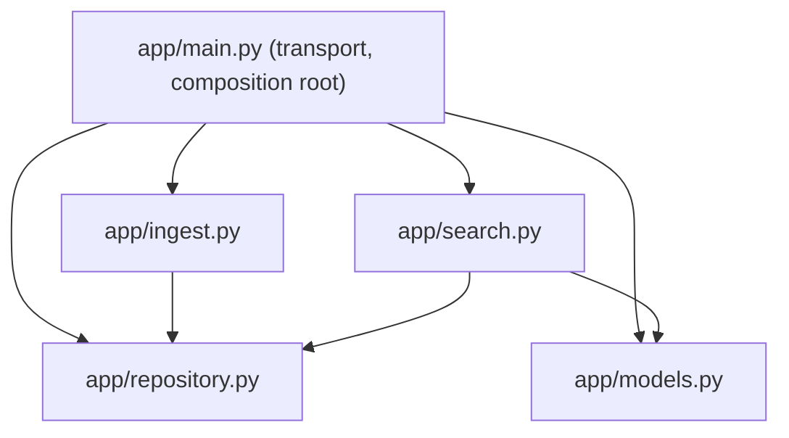
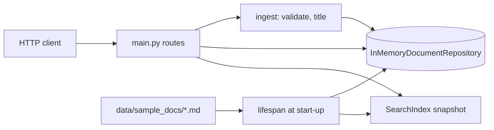

# Architecture Spine — docqa-lite

## Design Paradigm

**Thin transport + functional core + one port.** `app/main.py` is the only HTTP boundary and the only composition root. The core is plain modules with no framework imports. `DocumentRepository` is the only abstraction.

| Layer | Lives in | Role |
| --- | --- | --- |
| Transport / composition | `app/main.py` | Routes, `create_app()`, lifespan wiring, `app.state` |
| Core | `app/ingest.py`, `app/search.py` | Validation, title extraction, sample loading, TF-IDF index, snippets |
| Port + record | `app/repository.py` | `Document`, `DocumentRepository`, in-memory adapter |
| Wire shapes | `app/models.py` | pydantic v2 response models |

## Invariants & Rules



Arrows are the only permitted imports. `repository` and `models` import nothing from `app`. `ingest` and `search` never import each other, `main`, or FastAPI.

### AD-1 — Dependency direction and composition root [ADOPTED]

- **Binds:** all
- **Prevents:** core modules reaching into the web layer, or two places wiring `app.state` differently
- **Rule:** Imports follow the diagram. Only `create_app()` builds the repository, index and lock, and only in its lifespan. Shared state lives on `app.state` (`repository`, `index`, `lock`) and nowhere else. Module-level mutable state is forbidden; each `create_app()` call yields an isolated library. Routes that take `app.state.lock` stay sync `def`: FastAPI runs them in a threadpool, and a `threading.Lock` inside an `async def` route would block the event loop. State exists only inside the lifespan, so a bare `TestClient(app)` has no library; tests use the `client` fixtures.

### AD-2 — Repository is the sole storage seam [ADOPTED]

- **Binds:** FR1, FR2, FR4, FR5
- **Prevents:** code that reads or writes documents around the port, or mutates a `Document`
- **Rule:** All document storage goes through `DocumentRepository` (`add`, `get`, `list`). `Document` is a frozen dataclass; changing a document means adding a new record. A new storage backend implements the Protocol and is swapped in `create_app()`. No other module touches the backend's internals. Every adapter honours the port contract: `list()` returns documents in insertion order, ids are unique (`add` with an existing id is a caller bug and an adapter may raise), and `get` returns `None` for an unknown id. Any new adapter must pass the same contract tests as the in-memory one.

### AD-3 — The index mirrors the repository

- **Binds:** FR3, FR6
- **Prevents:** stale search after a future mutation path (delete, update, bulk load) changes the repository without rebuilding the index
- **Rule:** Every library mutation does the repository change and the index rebuild together, inside `app.state.lock`, and is all-or-nothing: if the rebuild fails, the repository and the index are both left as they were, and the failure is a logged 5xx, never a silent mismatch. The upload route's inline `with lock: add; rebuild` block is the one sanctioned instance today. Before a second mutation caller (delete, update, bulk load) exists, that block is extracted into one named function, and from then on only that function and the lifespan may call `repository.add` or `index.rebuild`.

### AD-4 — Eager full rebuild, atomic snapshot swap [ADOPTED]

- **Binds:** FR3, FR6, NFR1
- **Prevents:** search seeing a half-built index, or scores that differ between a full and an incremental build
- **Rule:** The index is rebuilt in full on every mutation and replaces the previous `_Snapshot` in a single reference assignment (the design must not depend on the GIL). Search reads the current snapshot without taking the lock, so its cost grows with snapshot size and nothing else; NFR1 is measured on that path. Perf tests seed 1,000 documents through the repository and one rebuild, not through 1,000 uploads. Incremental or lazy index updates are not allowed: TF-IDF weights depend on the whole corpus, and FR6 requires identical results for the same Query over the same Library.

### AD-5 — Exactly one process

- **Binds:** all
- **Prevents:** divergent libraries across workers or replicas, so FR3 ("searchable on the next search") breaks silently
- **Rule:** The service runs as one process: no `--workers`, no replicas. Library state is in memory and is lost on restart, by design. Anything multi-process or persistent starts as a new spine decision at the `DocumentRepository` seam.

### AD-6 — Validation sits at the boundary and never yields a 5xx [ADOPTED]

- **Binds:** FR2, NFR2
- **Prevents:** unvalidated input reaching the core, or divergent status codes and error bodies
- **Rule:** Upload checks live in `ingest.py` (`sanitize_filename`, `check_extension`, `decode_upload`) and raise `UploadRejected(status_code, detail)`. The route turns that into `HTTPException(status, detail)`. Query limits (length 1 to 500, non-blank, `k` from 1 to 20) are enforced by the route's `Query` declarations plus the whitespace check, with 422. Status map: 413 too large, 415 wrong type, 422 invalid content or query, 404 unknown id. Two error body shapes exist and both are frozen (AD-9): rejections raised by this code carry `detail` as a string; framework validation errors (bad `q`, bad `k`, missing `file`) keep FastAPI's default 422 with `detail` as a list. No custom exception handlers are registered. Uploads are read with a bounded read of `MAX_BYTES + 1`; `Content-Length` is never trusted. Filenames are reduced to a base name before any use.

### AD-7 — Result determinism and ordering [ADOPTED]

- **Binds:** FR4, FR6
- **Prevents:** unstable ordering or score formats that break clients and tests
- **Rule:** `GET /documents` returns samples first (sorted by filename), then uploads in upload order. Search orders results by rounded score descending, then by insertion order. Scores are rounded to 4 decimal places, capped at 1.0, and zero scores are dropped after rounding. `[ASSUMPTION]` Today's code sorts on the raw score; the two differ only when raw scores tie after rounding, and the rounded key is the rule. Snippets are at most 200 characters. No wall-clock time, randomness or external service influences a result.

### AD-8 — Content is never logged [ADOPTED]

- **Binds:** NFR2
- **Prevents:** document text or query text leaking through logs, error details or traces
- **Rule:** Log through the `docqa` logger as `key=value` events carrying ids, filenames and sizes only. Never log document content or query text. `UploadRejected.detail` and `HTTPException` details written by this code never contain file content. The `query` field in a successful search response is part of the frozen contract and stays. `[ASSUMPTION]` The uvicorn access log prints the request line, query string included, so run targets start uvicorn with the access log off (`--no-access-log`).

### AD-9 — The public API contract is frozen [ADOPTED]

- **Binds:** NFR3
- **Prevents:** a change to endpoints, status codes or response shapes slipping in as a side effect
- **Rule:** Endpoints, status codes and response shapes are fixed by `specs/001-document-library-search/contracts/` and the existing test suite. Changing them is outside this spine and needs a new PRD decision.

### AD-10 — One admission gate for every document

- **Binds:** FR1, FR2, FR3, NFR2
- **Prevents:** a document that bypasses upload checks entering the library, for example a sample that is empty or over 1 MB, which makes `GET /documents` fail response validation and return a 5xx for everyone
- **Rule:** Every document passes the same checks before `repository.add`, whatever its source (upload or sample). The checks cover size from 1 to 1,048,576 bytes, valid UTF-8, non-empty text, title 1 to 200 characters and filename 1 to 255 characters. The wire models' field constraints in `models.py` are never stricter than this gate. A sample that fails is skipped and logged by filename, never added. `[ASSUMPTION]` Open: whether `.markdown` files are loaded as samples, and whether an upload with no indexable terms (for example only stop words) is accepted. Today it returns 201 and can never be found.

## Consistency Conventions

| Concern | Convention |
| --- | --- |
| Naming | Wire models in `models.py` are `*Out` or `*Summary`. The domain record is the frozen `Document`. Routes convert with `model_validate`. |
| IDs and formats | Ids are `uuid4().hex` from `new_id()` only. Error bodies keep the two shapes in AD-6. `size` is the byte length of the stored upload, not the character count. |
| Limits and config | Limits are module constants (for example `MAX_BYTES`). There is no config or environment layer. |
| Logging | Logger `docqa`; `key=value` events (see AD-8). |
| Python level | Write to the 3.11 floor (`requires-python >= 3.11`, ruff `py311`), even though the venv runs 3.12. |
| Tests | Test first. Library tests use the `client` / `make_client` fixtures from `tests/conftest.py`, never a bare `TestClient(app)`. `DOCQA_PERF=1` gates every wall-clock check. |
| Run targets | Only `make run` and the in-process `TestClient`. There is no deployment spec. |

## Stack

A snapshot of the project environment (`.venv`) at authoring, not web-checked. `pyproject.toml` declares only lower bounds and there is no lockfile, so a fresh install can differ.

| Name | Version | Declared floor |
| --- | --- | --- |
| Python | 3.12.3 in the venv | 3.11 |
| FastAPI | 0.165.0 | 0.110 |
| Starlette | 1.10.0 | none |
| pydantic | 2.14.4 | none |
| scikit-learn | 1.9.1 | 1.4 |
| scipy | 1.18.1 | none |
| numpy | 2.5.5 | none |
| python-multipart | 0.0.34 | 0.0.9 |
| uvicorn | 0.54.0 | 0.29 |
| pytest | 9.2.0 | none |
| ruff | 0.17.6 | none |

## Structural Seed



```text
app/        main.py  repository.py  ingest.py  search.py  models.py  __init__.py
data/sample_docs/   five Markdown policy documents loaded at start-up
tests/      pytest, in-process; conftest.py holds the client fixtures
specs/001-document-library-search/   spec, plan, research, data model, contracts, tasks
```

## Capability → Architecture Map

| Capability / Area | Lives in | Governed by |
| --- | --- | --- |
| FR1 load samples | `ingest.load_sample_dir`, lifespan | AD-1, AD-2, AD-7, AD-10 |
| FR2 upload | `main.upload_document`, `ingest` | AD-2, AD-3, AD-6, AD-8, AD-10 |
| FR3 searchable at once | `main.upload_document`, `search.SearchIndex` | AD-3, AD-4, AD-5 |
| FR4 list | `main.list_documents` | AD-2, AD-7 |
| FR5 get | `main.get_document` | AD-2, AD-6 |
| FR6 search | `search.SearchIndex`, `make_snippet` | AD-4, AD-7 |
| NFR1 speed | `search.SearchIndex` | AD-4 (lock-free reads over a prebuilt snapshot) |
| NFR2 validation | `ingest`, route `Query` limits | AD-6, AD-8, AD-10 |
| NFR3 compatibility | whole API | AD-9 |

## Deferred

| Item | Why it can wait | Revisit when |
| --- | --- | --- |
| Ceiling for eager rebuild | Upload latency at about 1,000 documents is unmeasured and has no requirement | It becomes a stated requirement |
| Multi-process or persistent storage | Out of PRD scope and barred by the constitution | A real deployment needs it; start at the repository seam |
| Update and delete endpoints | Out of PRD scope | They are added; AD-3 then applies |
| Deployment target and environments | None named by the user | A target is chosen |
| Config via environment | No variable needs it yet | A limit must differ per environment |
| Cap on library size or total bytes | Memory is unbounded today; the PRD sets no limit and the service is single-user scale | The service is exposed beyond a trusted audience |
| Log handler and level for the `docqa` logger | No handler is configured, so INFO events may be dropped; correctness does not depend on them | Operations need to read those events |
| Multipart body spooled before the 413 check | Bounded by the server and fine at this scale | The service is exposed beyond a trusted audience |
| Missing sample directory gives an empty library without a warning | Harmless for training use | A deployment relies on the samples |
| Import-graph test for AD-1 and AD-5 | Both are checked by review today | A violation slips through review |
